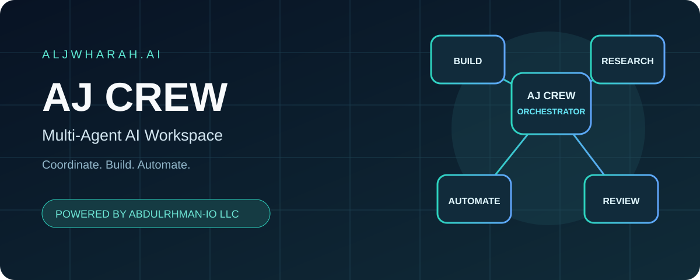
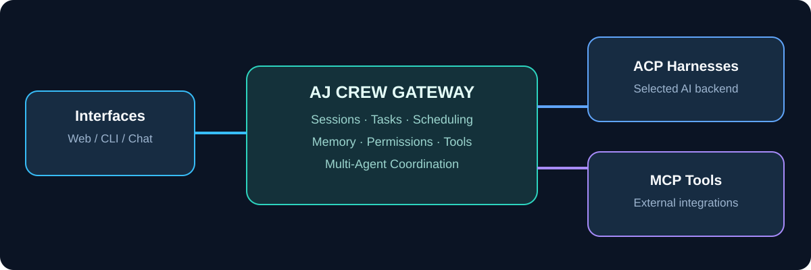

<p align="center"></p>

<h1 align="center">AJ CREW</h1>
<p align="center"><strong>Coordinate intelligent agents. Build with multiple AI backends. Automate complex work.</strong></p>
<p align="center">An independent multi-agent workspace developed under <strong>Aljwharah.ai</strong>, a technology brand of <strong>ABDULRHMAN-IO LLC</strong>, a company registered in Wyoming, United States.</p>
<p align="center"><a href="https://aljwharah.ai">Website</a> · <a href="docs/README.md">Documentation</a> · <a href="docs/guides/install.md">Installation</a> · <a href="mailto:support@aljwharah.ai">Support</a></p>

## The platform

**Aj Crew** brings AI agent orchestration, development workflows, task automation, memory, and integrations into one self-hostable workspace. It supports an interactive dashboard, command-line access, specialized agent sessions, and scheduled or background tasks.



### Key capabilities

| Capability | What it enables |
|---|---|
| Multi-agent orchestration | Delegate work to specialized agents and coordinate parallel sessions |
| Flexible AI backends | Select compatible ACP harnesses and their configured models |
| Autonomous workflows | Run multi-step tasks, recurring jobs, and monitored processes |
| Persistent context | Retain project knowledge, preferences, and lessons across supported sessions |
| Development tools | Work with files, commands, browser tools, and connected MCP services under configured permissions |
| Multiple interfaces | Access the workspace through the dashboard, CLI, and supported messaging channels |
| Self-hosted operation | Run the gateway on your infrastructure and configure service persistence |

> **Deployment note:** 24/7 operation requires a continuously running host or service. Telegram and other channels require their own credentials and setup. Backend availability depends on installed adapters and their authentication requirements.

## Quick start

Build from the source checkout. See the [installation guide](docs/guides/install.md) for operating-system requirements and backend prerequisites.

```bash
git clone https://github.com/Al-jwharah/Aj-Crew.git
cd Aj-Crew
make build
source .venv/bin/activate
ajcrew setup
ajcrew doctor
ajcrew gateway
```

Open `http://localhost:5476` after the gateway starts. On Windows, follow the [Windows installation guide](docs/guides/windows-install.md).

### Explore

- [Documentation](docs/README.md)
- [Architecture](docs/architecture/overview.md)
- [Local and hosted AI models](docs/guides/local-and-hosted-models.md)
- [Custom model endpoint](docs/guides/custom-llm-backend.md)
- [Docker deployment](docs/guides/docker.md)
- [Security policy](SECURITY.md)

## Company

**Aljwharah.ai** is the product and technology identity used by **ABDULRHMAN-IO LLC**, a limited liability company registered in the State of Wyoming, United States, on November 6, 2025.

**Website:** https://aljwharah.ai

| Department | Contact |
|---|---|
| Customer support | [support@aljwharah.ai](mailto:support@aljwharah.ai) |
| Sales and business | [sales@aljwharah.ai](mailto:sales@aljwharah.ai) |
| Engineering and development | [dev@aljwharah.ai](mailto:dev@aljwharah.ai) |

*Email addresses are published as contact destinations; mailbox provisioning and delivery must be configured separately.*

## Intellectual property and licensing

**Aj Crew's independently authored branding, original artwork, and original proprietary additions are reserved by ABDULRHMAN-IO LLC, subject to applicable third-party rights.** No license to use the Aljwharah.ai name or Aj Crew trademarks is granted by this README.

**Important:** This repository includes code derived from the upstream [Kiro Crew](https://github.com/kirodotdev/KiroCrew) project. Upstream Apache License 2.0 obligations and applicable third-party notices remain in force for covered code. See [LICENSE](LICENSE) and [NOTICE](NOTICE). Describing the project as proprietary does **not** revoke existing open-source rights or relicense upstream contributions.

This is an independent project and is not endorsed by or affiliated with its upstream authors.

<p align="center"><sub>© 2026 ABDULRHMAN-IO LLC · Aljwharah.ai · Aj Crew</sub></p>
